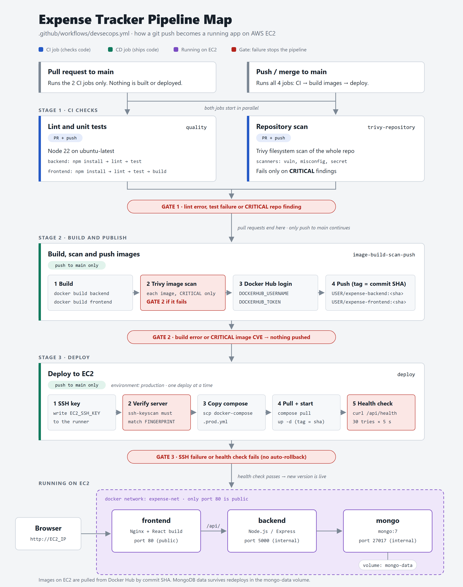
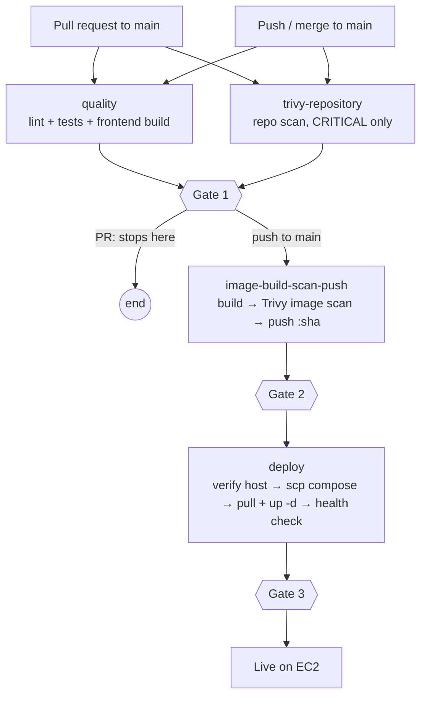

# Expense Tracker Pipeline Map

How a `git push` becomes a running app on AWS EC2, based on [`.github/workflows/devsecops.yml`](../.github/workflows/devsecops.yml). Each stage runs only if every stage before it passed.



> Source diagram: [`pipeline-map.svg`](pipeline-map.svg). Edit the SVG, then export it again to PNG.

## Flow at a glance



## Stages

| Stage | Job | Runs on | What it does | Stops the pipeline when |
|---|---|---|---|---|
| 1 | `quality` | PR + push | Node 22. Backend: `npm install → lint → test`. Frontend: `npm install → lint → test → build` | Lint error or failing test |
| 1 | `trivy-repository` | PR + push | Trivy filesystem scan (`vuln`, `misconfig`, `secret`) of the whole repo | Any CRITICAL finding, or Trivy itself errors |
| 2 | `image-build-scan-push` | push to `main` | Builds backend + frontend images, scans each with Trivy, logs in to Docker Hub, pushes `USER/expense-*:<commit-sha>` | Build error or CRITICAL image CVE (nothing is pushed) |
| 3 | `deploy` | push to `main` | Writes SSH key, verifies EC2 host fingerprint, copies `docker-compose.prod.yml`, runs `compose pull` + `up -d`, polls `/api/health` (30 × 5 s) | SSH/fingerprint failure or failed health check |

`quality` and `trivy-repository` run in parallel. `image-build-scan-push` waits for both. `deploy` waits for `image-build-scan-push`, uses the `production` environment, and runs one deployment at a time.

## What runs on EC2

```
Browser ──► frontend (Nginx + React, :80 public) ──/api/──► backend (Express, :5000) ──► mongo (:27017) ── volume: mongo-data
                       └──────────────────── docker network: expense-net ────────────────────┘
```

Only port 80 is published. The backend and MongoDB are reachable only inside `expense-net`. MongoDB data is kept in the `mongo-data` volume across redeploys.

## Settings the pipeline reads

| Name | Type | Used by | Purpose |
|---|---|---|---|
| `DOCKERHUB_USERNAME` | Variable | build, deploy | Image name prefix and login user |
| `DOCKERHUB_TOKEN` | Secret | build, deploy | Push from the runner, pull on EC2 |
| `EC2_HOST` | Variable | deploy | Server address |
| `EC2_USER` | Variable | deploy | SSH user, usually `ubuntu` |
| `EC2_SSH_KEY` | Secret | deploy | Proves the runner may log in (client auth) |
| `EC2_HOST_FINGERPRINT` | Variable | deploy | Proves the server is really yours (server auth) |

## Notes

- HIGH, MEDIUM and LOW findings do not fail the pipeline. Only CRITICAL does.
- If Trivy can't download its database, the job fails. Retry it; don't bypass the gate.
- If the health check fails, the new version may already be running. There is no automatic rollback.
